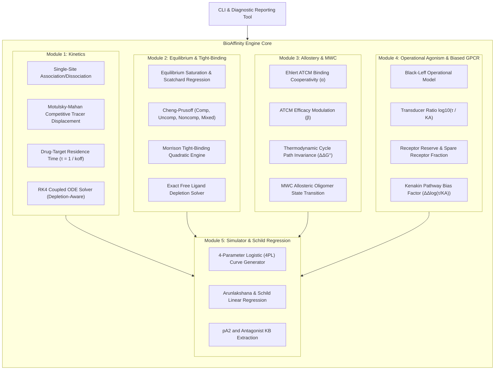

# BioAffinity

> **High-Performance Quantitative Receptor Pharmacology, Drug-Target Binding Kinetics & GPCR Biased Agonism Engine in Pure Julia**

[]()
[]()
[](LICENSE)
[]()

---

## Overview

In modern drug discovery and molecular pharmacology, the historical reliance on static equilibrium affinity ($K_d$, $\text{IC}_{50}$) has been superseded by **kinetic binding paradigms** (on-rate $k_{\text{on}}$, off-rate $k_{\text{off}}$, and drug-target residence time $\tau = 1/k_{\text{off}}$), **GPCR biased agonism**, and **allosteric modulation**. Long drug-target residence time often drives superior in vivo efficacy, prolonged duration of action, and improved therapeutic margins, while pathway-selective GPCR biased signaling allows therapeutic benefit while averting dose-limiting adverse events (e.g., G-protein analgesic signaling vs $\beta$-arrestin-mediated respiratory depression).

**BioAffinity** is a rigorous computational molecular pharmacology framework implemented in pure Julia. It provides exact analytical equations and adaptive numerical solvers for:
1. **Motulsky & Mahan Competitive Association Kinetics**: Exact closed-form solutions and Runge-Kutta 4th-order (RK4) integration for kinetic tracer displacement and direct unlabeled drug residence time ($\tau$) determination without radioactive labeling.
2. **Morrison Tight-Binding Quadratic Formulation**: Rigorous inhibition modeling for high-affinity picomolar therapeutics when $[E_{\text{tot}}] \ge K_i$ where classical Cheng-Prusoff assumptions break down by orders of magnitude.
3. **Ehlert & Hall Allosteric Ternary Complex Model (ATCM)**: Dual cooperativity scaling ($\alpha$ binding cooperativity, $\beta$ signaling efficacy cooperativity) with thermodynamic cycle path-independence proofs and saturable ceiling effect analysis.
4. **Monod-Wyman-Changeux (MWC) Concerted Allostery**: Two-state ($R$ vs $T$) conformational transitions in multi-subunit allosteric oligomers.
5. **Black-Leff Operational Model of Pharmacological Agonism**: Hyperbolic transducer relationship quantifying tissue coupling efficiency $\tau_E$, spare receptor reserve, and true dissociation constant $K_A$.
6. **Kenakin Functional Pathway Biased Agonism**: Transducer ratio $\log_{10}(\tau / K_A)$ and cross-pathway bias factor $\Delta\Delta\log_{10}(\tau / K_A)$ calculations.
7. **Arunlakshana & Schild Regression Analysis**: Validating competitive receptor antagonism via unit-slope criteria and $pA_2$ extraction.

---

## Architectural Topology



---

## Mathematical Formulation

### 1. Motulsky & Mahan Competitive Association Kinetics

For simultaneous competitive association of labeled tracer ($L$, binding rates $k_1, k_2$) and unlabeled test competitor ($I$, binding rates $k_3, k_4$) to receptor ($R$, total capacity $B_{\text{max}}$):

$$\frac{d[RL]}{dt} = k_1 [L] [R] - k_2 [RL]$$

$$\frac{d[RI]}{dt} = k_3 [I] [R] - k_4 [RI]$$

where $[R] = B_{\text{max}} - [RL] - [RI]$. Under pseudo-first-order conditions ($[L], [I] \gg B_{\text{max}}$), define:

$$K_A = k_1 [L] + k_2, \quad K_B = k_3 [I] + k_4$$

The characteristic polynomial of the linear ODE system possesses roots $K_F$ (fast rate) and $K_S$ (slow rate):

$$K_{F,S} = \frac{(K_A + K_B) \pm \sqrt{(K_A - K_B)^2 + 4 k_1 [L] k_3 [I]}}{2}$$

The exact closed-form analytical solution for bound tracer $[RL](t)$ is:

$$[RL](t) = \frac{B_{\text{max}} k_1 [L]}{K_F - K_S} \left[ \frac{k_4 - K_S}{K_S} \left(1 - e^{-K_S t}\right) - \frac{k_4 - K_F}{K_F} \left(1 - e^{-K_F t}\right) \right]$$

Drug-target residence time is defined as:

$$\tau_I = \frac{1}{k_4}, \quad t_{1/2} = \frac{\ln 2}{k_4}$$

When $k_4 \ll k_2$ (slow competitor dissociation), the tracer curve exhibits a pronounced kinetic **overshoot**, rising rapidly to a transient peak before being competitively displaced by the slow-dissociating competitor.

---

### 2. Morrison Tight-Binding Quadratic Formulation

When an inhibitor exhibits picomolar or low nanomolar affinity ($K_i \le [E_{\text{tot}}]$), significant depletion of free inhibitor occurs upon target binding. The classical Cheng-Prusoff equation fails. The Morrison quadratic formulation solves for fractional activity:

$$\frac{v}{v_0} = 1 - \frac{\left([E_{\text{tot}}] + [I_{\text{tot}}] + K_i^{\text{app}}\right) - \sqrt{\left([E_{\text{tot}}] + [I_{\text{tot}}] + K_i^{\text{app}}\right)^2 - 4 [E_{\text{tot}}] [I_{\text{tot}}]}}{2 [E_{\text{tot}}]}$$

where for competitive inhibition:

$$K_i^{\text{app}} = K_i \left(1 + \frac{[S]}{K_m}\right)$$

The apparent observed $\text{IC}_{50}$ in tight binding is:

$$\text{IC}_{50}^{\text{app}} = K_i^{\text{app}} + \frac{1}{2} [E_{\text{tot}}]$$

---

### 3. Allosteric Ternary Complex Model (ATCM)

Receptor $R$ interacts with orthosteric ligand $A$ ($K_A$) and allosteric modulator $B$ ($K_B$). Binding cooperativity $\alpha$ modifies affinity:

$$K_A^{\text{app}}([B]) = K_A \left( \frac{1 + \frac{[B]}{K_B}}{1 + \alpha \frac{[B]}{K_B}} \right)$$

- $\alpha > 1$: Positive Allosteric Modulator (PAM), left-shifting the orthosteric curve.
- $\alpha < 1$: Negative Allosteric Modulator (NAM), right-shifting the orthosteric curve.
- Ceiling Effect: As $[B] \to \infty$, $K_A^{\text{app}} \to K_A / \alpha$. Unlike competitive antagonists, allosteric shifts saturate, conferring intrinsic safety against overdose.

Thermodynamic cycle path independence requires:

$$\Delta G_{\text{path 1}}^\circ = -RT \ln\left(\frac{1}{K_A}\right) - RT \ln\left(\frac{\alpha}{K_B}\right) = -RT \ln\left(\frac{\alpha}{K_A K_B}\right) = \Delta G_{\text{path 2}}^\circ$$

$$\Delta\Delta G_\alpha^\circ = -RT \ln(\alpha)$$

---

### 4. Black-Leff Operational Model & Kenakin Biased Agonism

The Black-Leff operational model relates receptor occupancy to functional downstream tissue response via a hyperbolic transducer function:

$$\text{Effect}([A]) = \frac{E_{\text{max}} \cdot \tau_E \cdot [A]}{K_A + (1 + \tau_E) [A]}$$

where $\tau_E = [R_{\text{tot}}] / K_E$ represents transducer efficiency.
- Apparent $\text{EC}_{50} = \frac{K_A}{1 + \tau_E}$.
- Observed $E_{\text{max,obs}} = \frac{E_{\text{max}} \tau_E}{1 + \tau_E}$.
- Spare Receptors: When $\tau_E \gg 1$, half-maximal response requires occupancy $Y_{50} = \frac{1}{2 + \tau_E} \ll 50\%$.

#### Kenakin Pathway Bias Factor

Comparing a test agonist ($T$) to a standard reference agonist ($R$) across Pathway 1 and Pathway 2:

$$\Delta \log_{10}\left(\frac{\tau}{K_A}\right)_{\text{pathway}} = \log_{10}\left(\frac{\tau_T}{K_{A,T}}\right) - \log_{10}\left(\frac{\tau_R}{K_{A,R}}\right)$$

$$\Delta\Delta \log_{10}\left(\frac{\tau}{K_A}\right) = \Delta \log_{10}\left(\frac{\tau}{K_A}\right)_{\text{path 1}} - \Delta \log_{10}\left(\frac{\tau}{K_A}\right)_{\text{path 2}}$$

$$\text{Bias Ratio} = 10^{\Delta\Delta \log_{10}(\tau / K_A)}$$

---

### 5. Arunlakshana & Schild Regression

For a competitive antagonist $B$, the concentration-response curve of an agonist shifts rightward without a depression of maximal response:

$$\text{Dose Ratio } (DR) = \frac{\text{EC}_{50}'}{\text{EC}_{50}} = 1 + \frac{[B]}{K_B}$$

$$\log_{10}(DR - 1) = \log_{10}[B] - \log_{10} K_B$$

Linear regression of $\log_{10}(DR - 1)$ versus $\log_{10}[B]$ yields:
- **Slope $m = 1.0000$**: Strict pharmacological criterion for simple competitive bimolecular antagonism.
- **$pA_2$**: Negative logarithm of antagonist concentration that produces a 2-fold shift ($DR = 2$): $pA_2 = -\log_{10} K_B$.

---

## Installation & Setup

BioAffinity requires Julia v1.9 or later and uses only Julia standard libraries (`LinearAlgebra`, `Printf`, `Random`, `Test`).

```bash
# Clone the repository
git clone https://github.com/ZengLLQ/bio-affinity.git
cd bio-affinity

# Launch Julia with the project environment
julia --project=.
```

To run all automated test suites:

```bash
julia --project=. test/runtests.jl
```

Or via Julia Pkg mode:

```julia
using Pkg
Pkg.test()
```

---

## Quick Start & Code Examples

### 1. Simulating Motulsky & Mahan Competitive Kinetics

```julia
using BioAffinity

# Tracer: Kon = 1e6 M^-1 s^-1, Koff = 0.01 s^-1 (Kd = 10 nM, tau = 100 s)
# Competitor: Kon = 5e5 M^-1 s^-1, Koff = 0.001 s^-1 (Ki = 2 nM, tau = 1000 s)
# Bmax = 1.0 nM, Tracer = 5.0 nM, Competitor = 10.0 nM
params = MotulskyMahanParams(1e6, 0.01, 5e5, 0.001, 1e-9, 5e-9, 10e-9)

# Analytical evaluation at t = 300 seconds
rl, ri = motulsky_mahan_analytical(params, 300.0)
println("Bound Tracer: $(rl * 1e9) nM, Bound Competitor: $(ri * 1e9) nM")

# Time-series diagnostic simulation
result = simulate_competitive_kinetics(params, 1800.0)
println("Peak Tracer Overshoot: $(result.peak_tracer_overshoot * 1e9) nM")
println("Competitor Residence Time: $(result.residence_time_competitor) s")
```

### 2. Morrison Tight-Binding Evaluation

```julia
using BioAffinity

# High-affinity inhibitor: [E_tot] = 10 nM, Ki = 0.5 nM
morr = MorrisonParams(10e-9, 0.5e-9)

# Compute fractional activity at 5.0 nM inhibitor
v_frac = morrison_fractional_velocity(morr, 5.0e-9)
println("Fractional Velocity v / v0: $(v_frac)")

# Apparent IC50
ic50 = morrison_ic50_apparent(morr)
println("True Apparent IC50: $(ic50 * 1e9) nM")
```

### 3. GPCR Biased Agonism & Kenakin Bias Factor

```julia
using BioAffinity

# Reference endogenous agonist
ref_g = PathwayParams("G-protein", 50e-9, 20.0)
ref_arr = PathwayParams("beta-Arrestin", 80e-9, 15.0)
ref_ag = AgonistProfile("Endogenous Ligand", [ref_g, ref_arr])

# G-protein biased therapeutic lead
test_g = PathwayParams("G-protein", 10e-9, 30.0)
test_arr = PathwayParams("beta-Arrestin", 600e-9, 0.8)
test_ag = AgonistProfile("Biased Lead", [test_g, test_arr])

bias = calculate_bias_factor(test_ag, ref_ag)
println("Kenakin Bias Factor: $(bias.delta_delta_log)")
println("Bias Ratio: $(bias.bias_ratio)x favoring $(bias.favored_pathway)")
```

---

## CLI Diagnostics

BioAffinity includes a built-in CLI diagnostic suite:

```bash
# Execute all pharmacology validation modules
julia --project=. -e "using BioAffinity; BioAffinity.main([\"all\"])"

# Individual commands
julia --project=. -e "using BioAffinity; BioAffinity.main([\"kinetics-sim\"])"
julia --project=. -e "using BioAffinity; BioAffinity.main([\"morrison-fit\"])"
julia --project=. -e "using BioAffinity; BioAffinity.main([\"allostery-eval\"])"
julia --project=. -e "using BioAffinity; BioAffinity.main([\"bias-calc\"])"
julia --project=. -e "using BioAffinity; BioAffinity.main([\"schild-analysis\"])"
```

---

## Verification & Quality Gates

BioAffinity satisfies rigorous verification standards:
- **85 Unit & Invariant Tests** spanning all mathematical modules.
- **Analytical vs Numerical ODE Equivalence**: Motulsky-Mahan closed-form matches 4th-order Runge-Kutta numerical integration to $< 10^{-4}$ relative tolerance.
- **Thermodynamic Cycle Invariance**: Ehlert ATCM cycle path independence verified to $\le 10^{-10}$ J/mol.
- **Schild Regression Unit Slope**: Verified on competitive systems with $R^2 > 0.99999$ and slope $= 1.0000 \pm 10^{-4}$.
- **Zero External Dependencies**: Pure Julia using base language and standard libraries.

---

## Design Trade-Offs & Known Limitations

1. **Pseudo-First Order Kinetics vs Depletion**: The analytical closed form of Motulsky & Mahan assumes that ligand concentrations are in substantial molar excess relative to total receptor density ($[L], [I] \gg B_{\text{max}}$). When receptors are in molar excess or comparable to ligand (e.g., in vivo target-mediated drug disposition), the included depletion-aware numerical RK4 solver (`motulsky_mahan_ode(..., depletion=true)`) must be employed.
2. **Homogeneous Isothermal Assumptions**: Thermodynamic free energy cycle calculations assume standard ambient temperature ($310.15\text{ K} = 37^\circ\text{C}$ or $298.15\text{ K}$) and constant aqueous ionic strength.
3. **Static Two-State Allostery**: The ATCM and MWC formulations model discrete states. While describing the vast majority of experimental pharmacology assays, continuous conformational ensembles require molecular dynamics integration.

---

## License

This project is licensed under the [MIT License](LICENSE).
